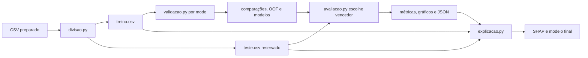
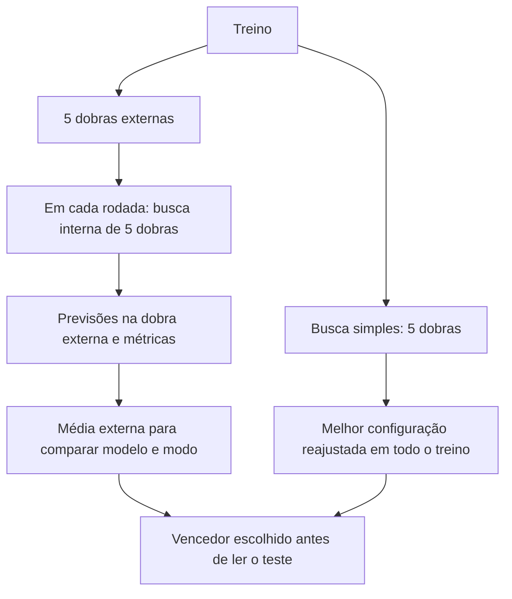

# Guia de execução e artefatos

Este guia descreve as interfaces atuais dos scripts. O pipeline não extrai dados do prontuário nem implementa limpeza, imputação ou codificação. Os resultados de testes com dados genéricos não são resultados clínicos.



## Entrada e execução

O CSV deve conter `id_prontuario`, `sepse_tardia` (0 ou 1, sem ausentes) e preditores numéricos sem valores ausentes. `carregar` verifica apenas a presença das duas colunas e os valores do alvo; não verifica unicidade ou ausência de identificadores, tipos dos preditores, nem vazamento temporal. Cabe ao responsável garantir uma linha por paciente e a adequação dos dados. O identificador e o desfecho são excluídos de X.

Após instalar as dependências conforme o README, um fluxo com os caminhos padrão é:

```powershell
.venv\Scripts\python.exe divisao.py --entrada data/dados.csv
.venv\Scripts\python.exe validacao.py --grade enxuta --desbalanceamento nenhum
.venv\Scripts\python.exe validacao.py --grade enxuta --desbalanceamento class_weight
.venv\Scripts\python.exe validacao.py --grade enxuta --desbalanceamento smote
.venv\Scripts\python.exe avaliacao.py --grade enxuta
.venv\Scripts\python.exe explicacao.py --grade enxuta
```

A validação pode ser demorada. `--modelos RL NB` limita os modelos, `--n-jobs` controla paralelismo e `--grade completa` amplia a busca. A avaliação considera os modos com comparação e pasta de modelos disponíveis para a grade; não exige que os três modos tenham sido executados. Use a mesma grade e dados coerentes em todas as etapas. Cada script oferece `--help`.

A divisão usa 20% para teste e semente 42 por padrão. A validação exige pelo menos 25 exemplos de cada classe no treino com as cinco dobras padrão. Esse mínimo é uma verificação de entrada, não garantia de que todas as combinações sejam viáveis: por exemplo, KNN exige vizinhos suficientes em cada ajuste e SMOTE exige pelo menos seis exemplos da classe minoritária em cada ajuste. Erros de ajuste interrompem a busca.



Em cada busca, seleciona-se o maior F1 médio; valores a até `1e-12` do máximo são tratados como empate e a AUROC média desempata. A avaliação escolhe o modelo e modo pelo F1 médio externo, depois AUROC; se ambos empatam, usa a ordem dos modos e modelos no catálogo. O pipeline avaliado no teste é o reajustado pela busca simples, não um dos cinco modelos externos. Selecionar entre várias alternativas com base na mesma validação pode introduzir otimismo na nota do vencedor.

A avaliação mede todas as combinações presentes no teste e calcula intervalos percentílicos de 95% por bootstrap para o vencedor (1.000 reamostragens válidas por padrão), descartando amostras com uma classe. Esses intervalos reamostram as previsões do teste com o modelo fixo; não incorporam a incerteza do treinamento ou da seleção. O teste precisa conter as duas classes.

As métricas de classificação usam `predict`; AUROC usa `predict_proba`. Para a matriz de confusão e o bootstrap do vencedor, o código classifica como positivo quando a probabilidade é **maior** que 0,5. Em caso de probabilidade exatamente 0,5, essa regra pode divergir do `predict` de algum estimador; por isso os números nessas saídas podem não coincidir com as métricas pontuais da tabela. As curvas ROC de treino usam as probabilidades fora da dobra reunidas em um único vetor; a AUROC da figura pode diferir da média das AUROCs por dobra registrada na comparação.

A reserva do teste é uma regra de trabalho, não um bloqueio implementado: scripts podem ser executados novamente, e a explicação lê o teste outra vez. Evite usar esses resultados para escolher modelos ou ajustar o processo. Resultados antigos podem ser sobrescritos; uma nova validação remove os arquivos `.joblib` anteriores da pasta correspondente ao mesmo modo e grade.

O programa não confere se comparações de modos diferentes foram produzidas com os mesmos dados, semente e modelos. Antes de avaliar, mantenha apenas resultados coerentes da rodada pretendida: comparações antigas de outros modos da mesma grade também entram na escolha. A explicação compara métricas do modelo carregado no teste com o JSON anterior, mas isso não comprova identidade dos arquivos ou dos dados de treino.

## Arquivos gerados

Todos os caminhos abaixo são relativos a `data/resultados/` por padrão; `<g>` é a grade e `<m>` o modo.

| Etapa | Arquivos |
|---|---|
| Validação | `comparacao_<g>_<m>.csv`, `oof_<g>_<m>.csv`, `modelos_<g>_<m>/<modelo>.joblib` |
| Avaliação | `avaliacao_teste_<g>.csv`, `vencedor_<g>.json`, `roc_oof_<g>_<m>.png`, `roc_teste_<g>_<m>.png`, `confusao_vencedor_<g>.png` |
| Explicação | `importancia_shap_<g>.csv`, `shap_resumo_<g>.png`, `shap_caso_<g>.png`, `modelo_final.joblib`, `modelo_final.json` |

O SHAP usa permutação na escala de probabilidade, até 100 linhas do treino como referência e as linhas do teste para explicar. O modelo final é o pipeline já ajustado no treino, acompanhado de metadados. `explicacao.prever(df)` devolve probabilidades; exige as colunas registradas, ignora extras com aviso e usa o identificador como índice quando presente. Os arquivos finais não incluem a grade no nome e são sobrescritos por outra execução.

```python
import pandas as pd
from explicacao import prever

novos = pd.read_csv("data/novos.csv")  # preditores com o mesmo preparo do treino
probabilidades = prever(novos)          # lê modelo_final.* de data/resultados
print(probabilidades)
```

As probabilidades são saídas do estimador; não há calibração implementada nem validação clínica neste repositório. A importância SHAP descreve o comportamento do modelo e não estabelece causalidade.

Os arquivos `joblib` devem ser carregados apenas de fontes confiáveis. Dependências em `requirements.txt` têm versões mínimas, não fixas; registre o ambiente utilizado para reproduzir uma análise.
