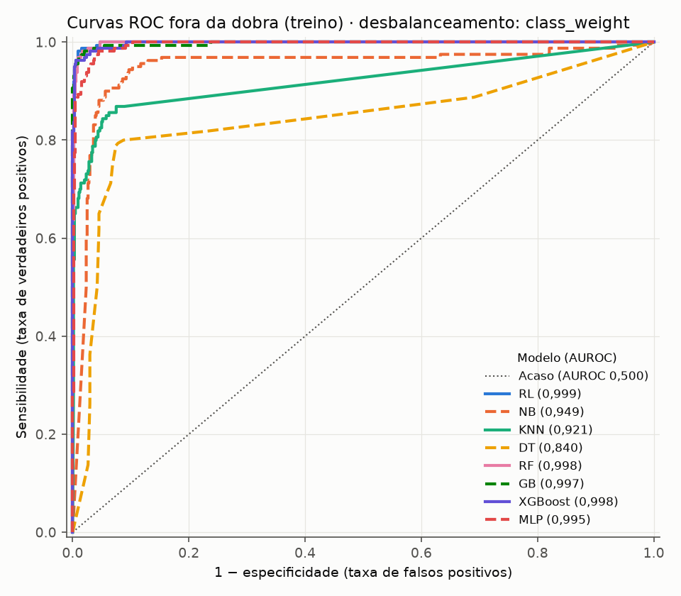
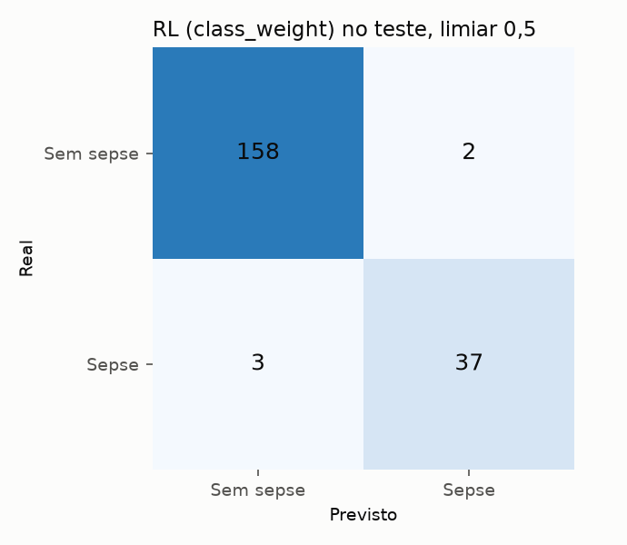
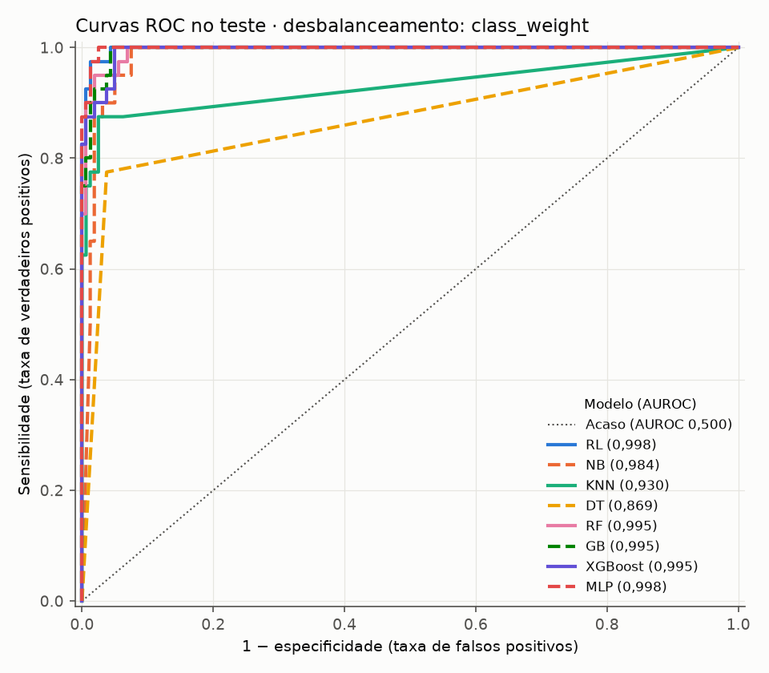
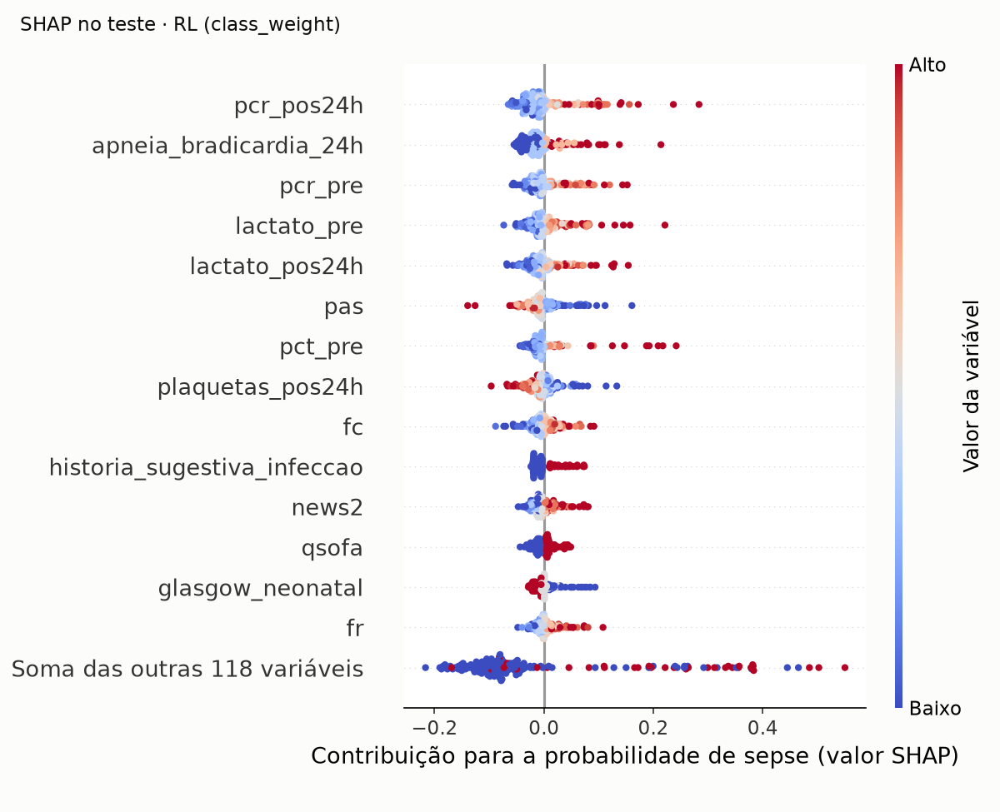
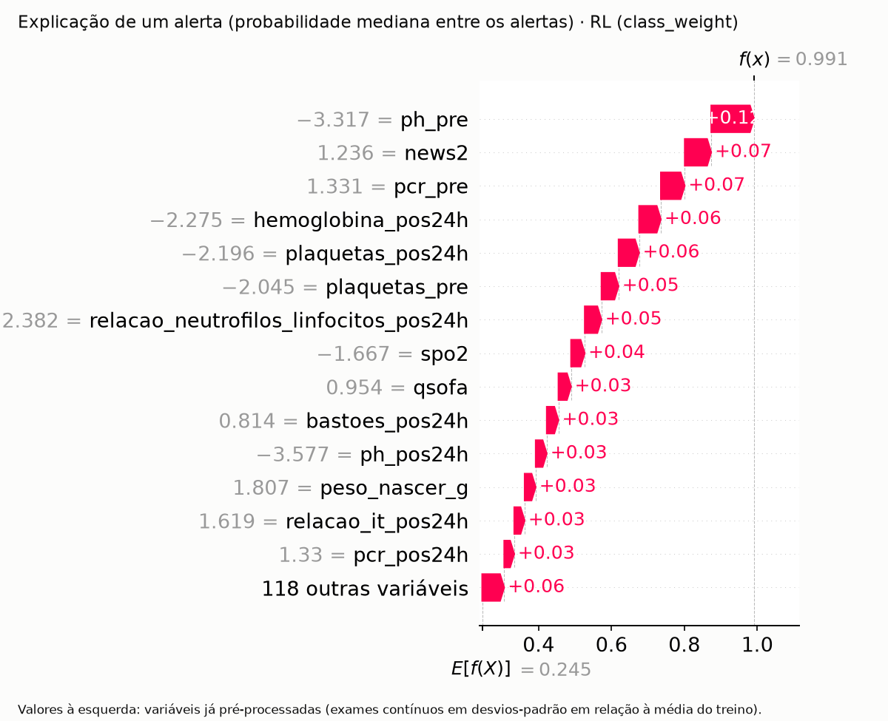

# Relatório do pipeline: predição de sepse neonatal tardia

Relatório do trabalho de construção do pipeline de aprendizado de máquina do estudo "Desenvolvimento de modelos de
inteligência artificial para predição de sepse tardia em Unidade de Terapia Intensiva Neonatal"
(`Projeto_sepse_07_07.pdf`). Descreve o que foi feito, por que cada decisão foi tomada, o que se obteve com dados
sintéticos, as dúvidas que surgiram na análise do projeto e o que será ajustado quando os dados reais estiverem
disponíveis.

Documentos relacionados: `docs/entendimento-do-projeto.md` (leitura do projeto e pontos em aberto),
`plans/plano-de-implementacao.md` (plano da implementação) e `README.md` (como executar). As páginas citadas são as
numeradas no PDF.

> **Aviso sobre os resultados.** Os dados reais dependem da aprovação no Comitê de Ética e do acesso ao prontuário
> eletrônico. Todos os números deste relatório foram obtidos com **dados sintéticos** gerados pelo próprio repositório e
> **não têm valor científico**. Eles servem para mostrar que o pipeline funciona de ponta a ponta e que as proteções
> metodológicas estão ativas.

## 1. Objetivo do trabalho

O estudo tem como objetivo desenvolver e avaliar algoritmos de inteligência artificial para a predição de sepse tardia
em recém-nascidos internados em UTIN (Resumo; seção 1.6.1, p. 16). A metodologia (seções 3.7 a 3.9, p. 42 a 46) pede:
oito algoritmos de classificação (Quadro 4), busca de hiperparâmetros com `GridSearchCV`, validação cruzada com k = 5,
divisão 80/20 entre treino e teste, as métricas do Quadro 5 com o F1-score como principal, comparação em tabela e em
curvas ROC, tratamento do desbalanceamento entre as classes e explicação do melhor modelo com valores SHAP.

O trabalho aqui relatado construiu esse pipeline por inteiro, deixando de propósito incompleta, mas isolada, a parte que
depende da forma dos dados reais (seção 7).

## 2. Visão geral

O pipeline segue as etapas do processo KDD (Figura 2, p. 42) e está dividido em módulos Python:

| Etapa do KDD | Estação | Módulo | O que faz |
|---|---|---|---|
| Seleção | Dados de entrada | `gerador_seed.py` | Gera a tabela sintética (será substituído pela extração real) |
| Pré-processamento | Auditoria | `preprocessamento.py` | Confere qualidade, critérios de inclusão e suspeitas de vazamento |
| Transformação | Pré-processador e divisão | `preprocessamento.py` | Prepara as variáveis e separa treino (80%) e teste (20%) |
| Mineração de dados | Treino e comparação | `modelos.py`, `validacao.py` | Treina os 8 algoritmos com busca de hiperparâmetros e validação cruzada |
| Avaliação | Avaliação final | `avaliacao.py` | Escolhe o vencedor, abre o teste uma vez, gera tabela e curvas ROC |
| Interpretação | Explicação | `explicacao.py` | Explica o vencedor com SHAP e salva o modelo final |

Três princípios atravessam todas as etapas:

1. **O conjunto de teste é aberto uma única vez**, na avaliação final, depois de o vencedor já estar escolhido.
2. **Nada é aprendido com dados que o modelo vai ser avaliado.** Medianas, escalas, pesos de classe e exemplos sintéticos
   (SMOTE) vêm só do treino de cada rodada da validação cruzada.
3. **Cada proteção tem um teste automático que falha se ela for quebrada.** A suíte tem 107 testes.

## 3. As etapas e as decisões

### 3.1 Dados sintéticos

**O que é.** Uma tabela com uma linha por recém-nascido e 99 colunas, que seguem as variáveis dos Quadros 2 e 3 (p. 39
e 40) e a ficha de coleta do apêndice (p. 65 a 67). Foram gerados 1.000 pacientes com 20% de sepse tardia (dentro da
faixa de 15% a 25% prevista na seção 3.2). Os exames seriados aparecem em duas janelas, `_pre` (última medida antes da
suspeita) e `_pos24h` (até 24 horas depois), conforme a seção 3.5.2.

**Como é gerada.** Primeiro as exposições (parto, internação, dispositivos), com dependências plausíveis entre si (por
exemplo, prematuridade aumenta o uso de cateter). Depois o desfecho, a partir de fatores de risco. Por fim, as
manifestações (sinais vitais, exames, microbiologia), deslocadas nos pacientes com sepse. Os valores ausentes são
inseridos ao acaso nos exames e na microbiologia.

**Por quê.** Permite construir e testar todo o pipeline antes dos dados reais. O gerador tem parâmetros que controlam a
força do sinal e a taxa de ausentes, o que permite testar o pipeline em cenários mais fáceis ou mais difíceis.

**Limitação.** Os efeitos são estimativas clínicas, e não derivam de dados reais. Com o parâmetro padrão, o sinal é
forte, e os modelos recuperam com facilidade o que foi plantado (AUROC próxima de 1). O desempenho com dados reais tende
a ser bem menor.

### 3.2 Auditoria

Antes de qualquer transformação, a auditoria resume a qualidade da tabela sem alterá-la: número de pacientes e de casos,
identificadores duplicados, violações dos critérios de inclusão (idade gestacional abaixo de 22 semanas, internação de 3
dias ou menos), taxa de ausentes por coluna, colunas quase constantes e a AUROC de cada variável sozinha contra o
desfecho.

Esta última verificação detecta **vazamento de alvo**: uma variável que prevê o desfecho quase perfeitamente costuma
conter informação do próprio desfecho. Nos dados sintéticos, ela apontou `dias_ate_dx_sepse` (AUROC 1,000), que só
existe para quem teve sepse. Essa coluna corresponde ao item "Intervalo de tempo para diagnóstico de sepse" do Quadro 2
e é **sempre removida** das variáveis de entrada.

### 3.3 Pré-processamento e transformação

O pré-processador transforma a tabela bruta (96 variáveis de entrada) numa matriz numérica sem ausentes (132 colunas nos
dados sintéticos). Os passos e o motivo de cada um:

| Passo | O que faz | Por quê |
|---|---|---|
| Hemocultura | Vazio em "agente isolado" e "perfil de sensibilidade" vira "não se aplica" (cultura negativa), "não informado" (cultura positiva) ou "não realizada" | O vazio, aqui, não é dado perdido: cultura negativa não tem agente. Preencher com moda ou mediana inventaria informação |
| `log1p` em exames de cauda longa | Aplica logaritmo em 14 exames (por exemplo, PCR, procalcitonina, leucócitos, lactato), nas duas janelas | Poucos valores muito altos distorcem a padronização e alguns modelos. A lista foi definida por conhecimento clínico, e não calculada dos dados, para valer igual com os dados reais |
| Imputação pela mediana | Ausentes numéricos recebem a mediana do treino | O PDF não detalha o procedimento de imputação (a p. 40 remete a uma descrição que não existe no texto). A mediana é simples, robusta e barata dentro da validação cruzada |
| Indicador "foi medido?" | Exames com 20% ou mais de ausentes no treino ganham uma coluna 0/1 | Na prática clínica, não pedir um exame pode carregar informação. Com limiar de 10% seriam 32 indicadores; com 20%, 11 |
| Padronização | Variáveis contínuas ficam com média 0 e desvio 1 | Necessária para KNN, MLP e Regressão Logística |
| Binárias | Colunas 0/1 passam sem alteração | Preserva a leitura "sim/não", inclusive no SHAP |
| One-hot | Categóricas viram colunas 0/1; ausente vira a categoria "ausente"; categoria nova no teste vira zeros | Formato exigido pelos algoritmos; robusto a categorias raras |

**Decisão importante: tudo é decidido no ajuste.** Quais colunas são binárias, quais exames passam do limiar de 20% de
ausentes, as medianas e as escalas são calculadas com os dados que o pipeline recebe no ajuste. Na validação cruzada,
isso significa só as dobras de treino de cada rodada. Assim, a dobra de validação não influencia nem a estrutura do
pré-processador. Essa correção foi feita durante o desenvolvimento, quando se percebeu que a primeira versão decidia a
estrutura com o treino inteiro.

**Alternativas avaliadas e descartadas.** Imputação por vizinhos mais próximos (KNN) e imputação iterativa foram
avaliadas. A iterativa levava 16,6 segundos por ajuste, com avisos de não convergência, o que a torna inviável dentro de
uma busca em grade. A pergunta "qual imputação é melhor?" é respondida de forma mais direta pelo desempenho do modelo
final, e um experimento de recuperação de valores escondidos não informaria nada sobre os dados reais, porque a ausência
nos dados sintéticos é aleatória. A imputação por KNN ficou como possível acréscimo futuro.

### 3.4 Divisão entre treino e teste

80% treino e 20% teste (p. 45), **estratificada pelo desfecho**: as duas partes mantêm a mesma proporção de sepse (nos
dados sintéticos, 160 de 800 no treino e 40 de 200 no teste). Os dois conjuntos são gravados em arquivos separados, e o
teste só é lido pela avaliação final.

O holdout 70/30 da seção 3.6 (Figura 1, p. 41) refere-se ao teste piloto do instrumento de coleta, e não à modelagem.

### 3.5 Treino e comparação dos algoritmos

**Os oito algoritmos** do Quadro 4 (p. 44): Regressão Logística (RL), Naive Bayes (NB), K-vizinhos mais próximos (KNN),
Árvore de Decisão (DT), Random Forest (RF), Gradient Boosting (GB), XGBoost e Rede Neural MLP. Cada um tem duas grades
de hiperparâmetros: a **enxuta** (59 combinações no total), usada para testar o pipeline, e a **completa** (325
combinações), prevista para os dados reais. Os valores das grades são iniciais e devem ser revistos com os dados reais.

**Desbalanceamento.** Como só cerca de 20% dos pacientes têm sepse, um modelo que diga "não" para todos já acerta 80%.
O PDF prevê avaliar "técnicas de reamostragem sintética e ajuste de pesos de classe" (p. 46). Foram implementados três
modos, e os três são comparados:

| Modo | O que faz | Observação |
|---|---|---|
| Nenhum | Sem correção | Referência |
| Pesos de classe | Erros nos casos de sepse pesam mais no treino | O scikit-learn não oferece esse recurso para KNN, NB e MLP, que neste modo rodam sem ajuste. Para GB e XGBoost, os pesos são calculados a cada ajuste, com a proporção do treino daquela rodada |
| SMOTE | Cria exemplos sintéticos de sepse por interpolação entre casos vizinhos | Age nos dados, então cobre os 8 algoritmos. Roda **só no treino** de cada ajuste, nunca na previsão |

O SMOTE exige cuidado: se for aplicado antes da divisão das dobras, exemplos sintéticos "vizinhos" de pacientes de
validação entram no treino, e o desempenho fica artificialmente alto. Um teste automático mostra isso: com o desfecho
embaralhado (nada a aprender), o SMOTE dentro do pipeline dá AUROC perto de 0,5, enquanto o SMOTE aplicado antes da
divisão dá cerca de 0,75 a 0,79. Uma limitação foi registrada: em colunas 0/1, o SMOTE cria valores fracionários (por
exemplo, sexo = 0,3).

**Duas estimativas de desempenho.** A busca em grade com 5 dobras (`GridSearchCV`) escolhe os hiperparâmetros de cada
algoritmo, mas a nota do vencedor é otimista: ele foi escolhido justamente por ter ido melhor naquelas dobras. Por isso
o pipeline também roda a **validação cruzada aninhada**: em cada uma de 5 rodadas externas, a busca inteira acontece em
4/5 do treino e o modelo escolhido é medido no 1/5 restante, que ele nunca viu. Essa é a nota usada para comparar os
algoritmos. Ela também gera, para cada paciente do treino, uma probabilidade prevista por um modelo que não o viu ("fora
da dobra"), que alimenta as curvas ROC do treino.

**Métrica de escolha.** F1-score com limiar 0,5, como define o Quadro 5. Empates são desfeitos pela AUROC. Acurácia,
precisão, recall (sensibilidade), especificidade e AUROC também são registradas. A especificidade não está no Quadro 5,
mas é citada no Resumo e complementa a sensibilidade.

### 3.6 Avaliação final

1. O vencedor (algoritmo e modo de desbalanceamento) é escolhido pelo maior F1 da validação aninhada, entre as 24
   combinações (8 algoritmos × 3 modos), **antes** de o arquivo de teste ser lido. Um teste automático verifica essa
   ordem.
2. O teste é aberto e todos os 24 modelos são medidos nele, para a tabela comparativa que o PDF pede.
3. Para o vencedor, calcula-se um intervalo de confiança de 95% por bootstrap (1.000 reamostragens dos pacientes do
   teste). Com cerca de 40 casos de sepse no teste, a nota pontual oscila bastante, e o intervalo mostra quanto.
4. São geradas as curvas ROC dos 8 algoritmos (fora da dobra no treino e no teste, uma figura por modo) e a matriz de
   confusão do vencedor.

### 3.7 Explicação e modelo final

**SHAP.** Para cada paciente, a probabilidade prevista é decomposta em um valor de referência (a probabilidade média do
modelo) mais uma contribuição de cada variável; as contribuições somam exatamente a diferença. Foi usado o mesmo método
(explicador por permutação, na escala de probabilidade) para qualquer algoritmo que vença, o que mantém a leitura
uniforme: "esta variável aumentou a probabilidade em tantos pontos". A explicação é feita sobre as variáveis já
pré-processadas, que são as que o modelo enxerga. Isso inclui os indicadores de ausência e as colunas one-hot com seus
nomes gerados; agrupá-los por variável original fica para quando as variáveis reais estiverem definidas.

São gerados a importância global (média do valor absoluto de cada variável), um gráfico de resumo e a explicação de um
paciente típico entre os classificados como sepse, que mostra como um alerta seria justificado.

**Modelo final.** O vencedor é salvo como um arquivo único que vai da tabela bruta até a probabilidade
(`modelo_final.joblib`), acompanhado de uma descrição (`modelo_final.json`) com o algoritmo, os hiperparâmetros, a forma
de escolha, as colunas de entrada esperadas, o limiar e as métricas. A função `prever` confere as colunas de uma tabela
nova contra essa descrição e devolve a probabilidade de cada paciente. Isso atende ao entendimento de que o produto do
estudo é um modelo integrável a um sistema de apoio à decisão, sem implementar esse sistema (ver
`docs/entendimento-do-projeto.md`, seção 1.2).

## 4. Resultados com os dados sintéticos

Execução de referência: 1.000 pacientes, 20% de sepse, semente 42, grade enxuta, comandos da seção 8. **Sem valor
científico.**

### 4.1 Validação cruzada aninhada (treino, 800 pacientes)

F1 médio das 5 rodadas externas, por algoritmo e modo de desbalanceamento:

| Algoritmo | Nenhum | Pesos de classe | SMOTE |
|---|---|---|---|
| RL | 0,965 | **0,969** | 0,953 |
| NB | 0,810 | 0,810 | 0,810 |
| KNN | 0,749 | 0,749 | 0,734 |
| DT | 0,818 | 0,756 | 0,829 |
| RF | 0,908 | 0,956 | 0,924 |
| GB | 0,937 | 0,962 | 0,952 |
| XGBoost | 0,961 | 0,968 | 0,948 |
| MLP | 0,925 | 0,925 | 0,948 |

Vencedor: **Regressão Logística com pesos de classe** (F1 0,969; AUROC 0,999). NB, KNN e MLP têm o mesmo resultado
em "nenhum" e "pesos de classe" porque, como explicado na seção 3.5, esse modo não se aplica a eles. No KNN, o SMOTE
trocou precisão por sensibilidade (recall de 0,61 para 0,97).



### 4.2 Teste (200 pacientes, 40 com sepse)

O vencedor no teste:

| Métrica | Valor | Intervalo de 95% |
|---|---|---|
| F1-score | 0,937 | 0,873 a 0,986 |
| Precisão | 0,949 | 0,867 a 1,000 |
| Recall (sensibilidade) | 0,925 | 0,833 a 1,000 |
| Especificidade | 0,988 | 0,969 a 1,000 |
| Acurácia | 0,975 | 0,955 a 0,995 |
| AUROC | 0,998 | 0,994 a 1,000 |

Dos 40 pacientes com sepse, o modelo identificou 37 e deixou de identificar 3. Dos 160 sem sepse, classificou 2 como
sepse.





**Por que o vencedor não é o de maior F1 no teste.** No teste, o MLP com SMOTE teve F1 de 0,974, acima do vencedor. Mas
escolher o modelo olhando o teste transformaria o teste em mais uma etapa de seleção, e a nota deixaria de ser uma
estimativa honesta para pacientes novos. Com 40 casos de sepse, diferenças dessa ordem cabem no intervalo de confiança.
A escolha pela validação aninhada é a que o desenho protege. A tabela completa dos 24 modelos no teste está em
`data/resultados/avaliacao_teste_enxuta.csv`.

### 4.3 Explicação

As variáveis de maior importância para o vencedor foram, em ordem: PCR até 24 h após a suspeita, episódios de
apneia/bradicardia, PCR antes da suspeita, lactato (nas duas janelas), pressão arterial sistólica, procalcitonina,
plaquetas, frequência cardíaca, história sugestiva de infecção, NEWS2, qSOFA, Glasgow neonatal, frequência respiratória
e critérios de disfunção orgânica. Essas são justamente variáveis que o gerador sintético altera nos pacientes com
sepse, o que mostra que a explicação recupera o sinal existente. Com dados reais, essa lista é o resultado do objetivo
específico 2.





## 5. Garantias de qualidade

- **107 testes automáticos.** Cobrem, entre outros pontos: a coluna de vazamento nunca chega ao modelo; o pré-processador
  aprende só com o treino de cada rodada; o SMOTE não vaza para a validação (com um controle que mostra que o teste
  detectaria o erro); as probabilidades fora da dobra ficam alinhadas a cada paciente; as métricas conferem com contas
  feitas à mão; o vencedor é escolhido antes de o teste ser lido; os valores SHAP somam a probabilidade prevista; o
  modelo salvo e recarregado prevê o mesmo.
- **Revisão independente.** As etapas foram revisadas de forma adversarial antes de serem registradas no histórico do
  projeto. Revisões e verificações levaram a correções como o cálculo dos pesos do XGBoost por rodada (antes, com o
  treino inteiro), a decisão da estrutura do pré-processador no ajuste e a verificação de que o modelo explicado é o
  mesmo que foi avaliado.
- **Reprodutibilidade.** Toda aleatoriedade tem semente fixa; a mesma execução gera os mesmos números.

## 6. Dúvidas que surgiram na análise do projeto

Pontos identificados ao confrontar o PDF com o que os dados precisam ter. Não têm resposta no código: dependem de
definição com a orientação. O primeiro está detalhado em `docs/entendimento-do-projeto.md`, seção 4.1.

1. **Qual pergunta o modelo responde?** A introdução fala em predizer a sepse com antecedência (p. 13), e os critérios
   de inclusão abrangem todos os recém-nascidos internados por mais de 72 horas. Já a coleta dos exames é ancorada no
   "momento da suspeita clínica", com medidas até 24 horas depois (seção 3.5.2), como em estudos que só incluem
   pacientes investigados. São duas perguntas diferentes:
   - **Alerta antes da suspeita:** "entre todos os internados, quem vai ter sepse?". Exige um marco comum para todos e só
     dados anteriores a ele.
   - **Apoio na suspeita:** "este recém-nascido investigado tem sepse?". Inclui só quem teve hemocultura colhida; os
     controles são os investigados sem sepse.

   Para recém-nascidos que nunca tiveram suspeita, o projeto não define qual exame usar. Se os casos tiverem exames do
   momento da suspeita e os controles não, o modelo pode aprender a reconhecer quem estava sendo investigado, e não a
   sepse. O próprio PDF cita um estudo que documenta esse fenômeno (Agniel; Kohane; Weber, 2018): o simples fato de um
   exame ter sido pedido previa o desfecho em 86% dos exames analisados.
2. **Variáveis que podem ser consequência da sepse.** Além de `dias_ate_dx_sepse` (já removida), algumas variáveis podem
   registrar o que aconteceu depois da sepse: dias totais de UTIN, de ventilação, de cateter e de nutrição parenteral,
   resultado da hemocultura, critérios de disfunção orgânica, uso de vasopressor e variáveis "durante a internação"
   (temperatura mínima, máxima e média). No cenário de apoio na suspeita, o resultado da hemocultura é praticamente o
   próprio desfecho. Recomenda-se contar dias e resumos só até o marco temporal escolhido.
3. **Exclusão ou imputação.** A seção 3.3 manda excluir prontuários com dados incompletos "para qualquer uma das variáveis
   utilizadas", enquanto a seção 3.5.2 manda tratar como ausente e imputar. Com cerca de 100 variáveis, a exclusão
   eliminaria a maior parte da amostra. O pipeline adota a imputação.
4. **Escores clínicos.** O nSOFA aparece no texto (seções 2.2.3 e 3.7, Figura 3), mas não no Quadro 3 nem na ficha de
   coleta, que têm Glasgow adaptada, NEWS2 e qSOFA. Os dados sintéticos seguem o Quadro 3.
5. **Regra de exclusão de algoritmos.** O Quadro 4 prevê excluir SVM e redes profundas "caso apresentem resultados abaixo
   de 70% nas métricas avaliadas", sem dizer em quais métricas. Esses algoritmos ainda não foram incluídos.
6. **Limiar de decisão e calibração.** O F1 depende do limiar de 0,5, que nenhuma parte do projeto discute. Em contexto
   clínico, pode ser preferível um limiar que priorize a sensibilidade. A calibração das probabilidades (se "70%" de fato
   corresponde a 70% de chance) também não está prevista.
7. **Rótulo.** O desfecho vem do CID registrado na evolução médica, sem exigência de confirmação (hemocultura ou
   tratamento). Convém confirmar também que o diagnóstico ocorreu depois de 72 horas de vida.

## 7. O que será ajustado quando os dados reais chegarem

O pipeline foi preparado para que a chegada dos dados exija mudanças pequenas e localizadas:

| O quê | Onde | Ajuste esperado |
|---|---|---|
| Fonte dos dados | `gerador_seed.py` | Substituído pela extração do SOUL MV, que entrega a tabela com uma linha por recém-nascido |
| Nomes e grupos de colunas | Constantes do topo de `preprocessamento.py` | Atualizar as listas de categóricas, exames, exames com `log1p`, coluna de vazamento e colunas sinalizadas |
| Variáveis permitidas | Constantes de `preprocessamento.py` | Remover ou recortar no tempo as variáveis do item 2 da seção 6, conforme a pergunta definida |
| Escores clínicos | Conector de extração | Calcular NEWS2, qSOFA (e nSOFA, se confirmado) a partir dos componentes brutos (p. 43) |
| Critérios de inclusão | Auditoria e extração | Confirmar a aplicação; incluir a regra de população que vier da definição da pergunta |
| Grades de hiperparâmetros | `modelos.py` | Usar a grade completa e revisar os valores |
| Análise de sensibilidade | `preprocessamento.py` e `validacao.py` | Treinar com e sem as variáveis sinalizadas, para medir quanto o desempenho depende delas |
| Acréscimos possíveis | Novos passos | SVM e redes profundas com a regra dos 70%; imputação por KNN; calibração e escolha de limiar; agrupamento do SHAP por variável original; análise estatística descritiva das variáveis associadas (objetivo específico 1) |

O que não deve mudar: a divisão treino/teste, a validação cruzada aninhada, os três modos de desbalanceamento, a regra
de escolha do vencedor, a avaliação final, a explicação e o salvamento do modelo.

## 8. Como reproduzir

Comandos para Windows (PowerShell), a partir da pasta do projeto. Os resultados são gravados em `data/resultados/`.

```powershell
.venv\Scripts\python.exe -m pip install -r requirements.txt
.venv\Scripts\python.exe gerador_seed.py --n 1000 --prevalencia 0.20 --sinal 1.0 --ausentes 1.0 --seed 42
.venv\Scripts\python.exe preprocessamento.py --entrada data/seed_sepse.csv --seed 42
.venv\Scripts\python.exe validacao.py --grade enxuta --desbalanceamento nenhum
.venv\Scripts\python.exe validacao.py --grade enxuta --desbalanceamento class_weight
.venv\Scripts\python.exe validacao.py --grade enxuta --desbalanceamento smote
.venv\Scripts\python.exe avaliacao.py --grade enxuta
.venv\Scripts\python.exe explicacao.py --grade enxuta
.venv\Scripts\python.exe -m pytest
```
